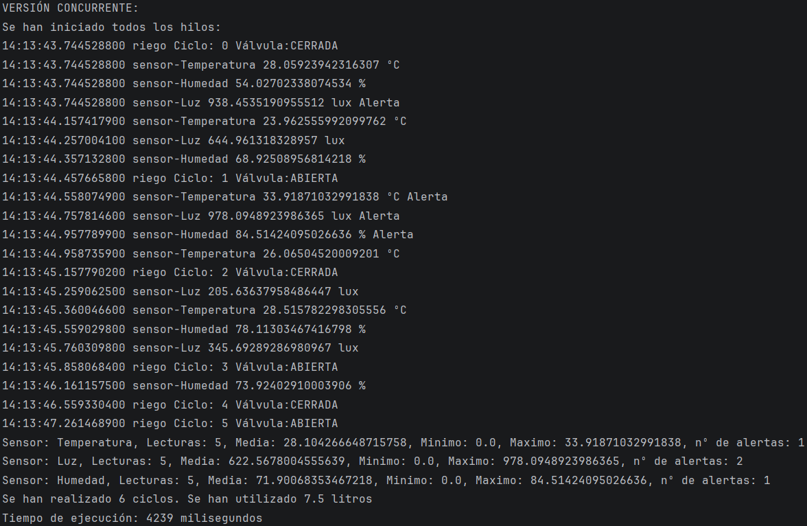

# UD4 Practica 1: Invernadero
## Qué hace
Este es un programa para simular la automatización de un invernadero. Está compuesto por 3 sensores (Temperatura, Luz y Humedad que implementan Runnable) y un programador de riegos que hereda de la clase Thread. A la hora de ejecutar, cada sensor realiza sus lecturas de forma independiente, mostrando sus estadísticas en un informe junto a las alertas que surgen cada vez que los valores superan los umbrales establecidos.
## Cómo ejecutarlo
Para ejecutar el programa:  
1.- Clonar el repositorio de forma local  
2.- Abrir el proyecto en un IDE con un JDK compatible (recomiendo JDK 25, ya que es el que he utilizado para programar)  
3.- Ejecutar cada fase de forma independiente.
## Captura ← una ejecución de la Fase 2

## Resultados Fase 1 y Fase 2 

| Nº de fase | Hilos                                                          | Resultado |
| :--- |:---------------------------------------------------------------|:----------|
| 1 | 1 hilo llamado main que ejecuta las tareas de forma secuencial | 11765ms   |
| 2 | 4 hilos independientes que se ejecutan de forma concurrente     |  4239ms   |  

## Análisis
### ¿Por qué compensa usar hilos en el invernadero?
Compensa porque en la versión secuencial sin hilos el programa pierde mucho tiempo en esperar a que un sensor termine sus lecturas antes de ejecutar el siguiente, mientras que con la concurrencia de hilos todos los sensores y el programador de riegos trabajan al mismo tiempo, lo que reduce el tiempo e ejecución al sensor más lento.
### Experimentos A, B y C (qué pasó y por qué)
#### Experimento A
__¿Qué sale la primera vez? ¿Por qué?__  
La primera vez los valores de mínimo, máximo y número de alertas están a 0. El resultado de la media es NaN (no existe). Esto ocurre porque se realiza el informe antes de que el sensor tenga tiempo de procesar sus lecturas, lo que hace que no obtenga ningún resultado para dicho informe.  
#### Experimento B
__¿Qué nombre de hilo sale en el log?__  
main  
__¿En qué estado está el objeto?__  
NEW  
__¿Por qué?__  
Porque al llamar directamente a run() se ejecuta el código como un método dentro de main, sin registrar ningún hilo nuevo en JVM, por lo que Thread no se pone en marcha y su estado interno queda como NEW.
#### Experimento C
__¿Qué excepción salta?__  
Sale IllegalThreadStateException. Esta excepción indica que un thread no se puede reutilizar o reiniciar una vez haya muerto, es decir, una vez que llegue al estado TERMINATED, no se puede invocar con start() otra vez.
### Estados observados (estado · cuándo · qué línea lo provoca)
| Estado | Cuando aparece | Qué lo provoca                                                                                              |
| :-- | :-- |:------------------------------------------------------------------------------------------------------------|
| NEW | Antes de ejecutar el hilo | new Thread(...) en el caso de los sensores o new ProgramadorRiego(...) en el caso del programador de riego. |
| RUNNABLE | En la ejecución | start()                                                                                                     |
| TIMED_WAITING | En las pausas | Thread.sleep(...)                                                                                           |
| TERMINATED | Al finalizar el hilo | El final del método run() de cada sensor |  

__¿Por qué termina el programa si el vigilante sigue en su bucle?__  
Porque el hilo de vigilante fue programado como demonio con el método vigilante.setDaemon(true), por lo que la máquina virtual de java no esperará a que este termine para terminar el programa, esperando solo a que los hilos principales mueran. 

### Thread frente a Runnable
__Tabla con al menos 4 aspectos__  

| Aspecto | Thread                                  | Runnable |
| :-- |:----------------------------------------| :-- |
| Que representa el objeto | El hilo en sí                           | La tarea que va a ejecutar el hilo |
| Como ejecutar | Llamando directamente al método start() | Envolviendo el objeto en un hilo con new Thread(objeto) y luego llamando al método start() |
| Como obtener el nombre | getName() | Thread.currentThread().getName() |
| Como hereda de otras clases | No se puede ya que java no soporta herencia múltiple (la clase ya hereda de Thread) | Permite heredar de otra clase si es necesario |  

__¿Por qué los sensores SOLO pueden ser Runnable en tu diseño?__  
Porque estos heredan de la clase abstracta Sensor, por lo que no pueden heredar de Thread debido a la limitación de java de no poder heredar de más de una clase.  

__¿Qué forma elegirías para el riego y por qué?__  
Elegiría la forma de Thread. Debido a que ProgramadorRiego no tiene que heredar de ninguna clase superior y debe funcionar como un hilo dedicado con riego como nombre fijo, la herencia directa de Thread mediante extends Thread simplifica su instanciación en gran medida, lo que nos permite cumplir con los requisitos del modelo de forma sencilla.
